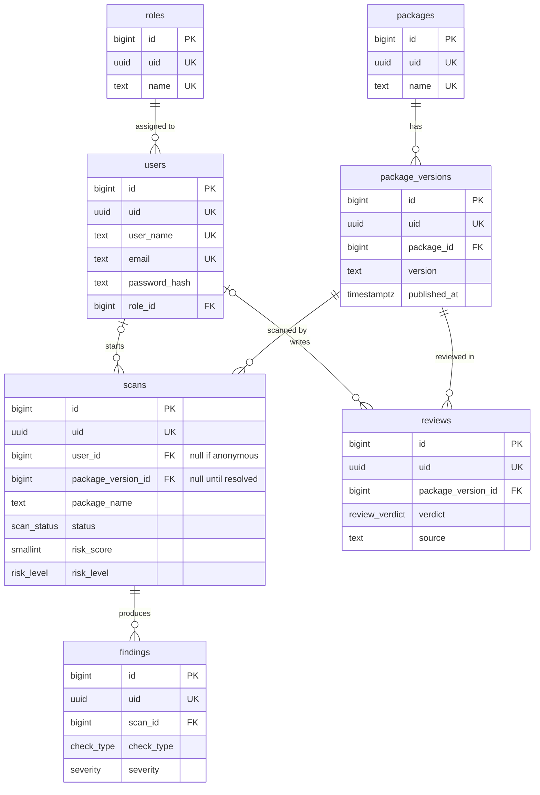

# Database Schema

PostgreSQL, managed with Prisma. This document is the design; `prisma/schema.prisma` (issue #5) implements it.

## Conventions

- Table and column names are `snake_case`; tables are plural. Prisma models are `PascalCase` singular and map to them with `@@map` / `@map`.
- Every table has two ids: `id bigint generated always as identity` (auto-increment primary key, used by foreign keys and joins) and `uid uuid default gen_random_uuid()` (unique, the only id exposed by the API).
- Timestamps are `timestamptz` in UTC.
- Fixed value sets are Postgres enums. Values that grow over time (review sources) are `text`.
- No soft deletes.

## ER diagram



## Enums

| Enum | Values |
| --- | --- |
| `scan_status` | `queued`, `running`, `completed`, `failed` |
| `scan_error` | `package_not_found`, `version_not_found`, `tarball_too_large`, `timeout`, `internal_error` |
| `risk_level` | `low`, `medium`, `high` |
| `severity` | `low`, `medium`, `high` |
| `check_type` | `install_scripts`, `typosquatting`, `obfuscation`, `maintainer_anomaly`, `suspicious_dependency` |
| `review_verdict` | `malicious`, `benign` |

## Tables

### `roles`

One row per role. Seeded with `user` and `admin`.

| Column | Type | Null | Notes |
| --- | --- | --- | --- |
| `id` | `bigint` | no | PK, identity (auto-increment) |
| `uid` | `uuid` | no | Unique, default `gen_random_uuid()` |
| `name` | `text` | no | Unique, e.g. `user`, `admin` |
| `description` | `text` | yes | What the role can do |
| `created_at` | `timestamptz` | no | Default `now()` |
| `updated_at` | `timestamptz` | no | Updated by Prisma |

### `users`

| Column | Type | Null | Notes |
| --- | --- | --- | --- |
| `id` | `bigint` | no | PK, identity (auto-increment) |
| `uid` | `uuid` | no | Unique, default `gen_random_uuid()` |
| `user_name` | `text` | no | Unique, stored lowercase. 3 to 30 characters: `a-z`, `0-9`, `_`, `-` |
| `email` | `text` | no | Unique, stored lowercase |
| `password_hash` | `text` | no | bcrypt or argon2 hash |
| `role_id` | `bigint` | no | FK → `roles.id`, on delete restrict. New users get the `user` role |
| `created_at` | `timestamptz` | no | Default `now()` |
| `updated_at` | `timestamptz` | no | Updated by Prisma |

### `packages`

One row per npm package name Sentinel has resolved on the registry.

| Column | Type | Null | Notes |
| --- | --- | --- | --- |
| `id` | `bigint` | no | PK, identity (auto-increment) |
| `uid` | `uuid` | no | Unique, default `gen_random_uuid()` |
| `name` | `text` | no | Unique, full name including scope (`@scope/name`) |
| `created_at` | `timestamptz` | no | Default `now()` |
| `updated_at` | `timestamptz` | no | Updated by Prisma |

### `package_versions`

One row per version Sentinel has resolved.

| Column | Type | Null | Notes |
| --- | --- | --- | --- |
| `id` | `bigint` | no | PK, identity (auto-increment) |
| `uid` | `uuid` | no | Unique, default `gen_random_uuid()` |
| `package_id` | `bigint` | no | FK → `packages.id`, on delete cascade |
| `version` | `text` | no | Exact semver, e.g. `1.2.3` |
| `published_at` | `timestamptz` | yes | From registry `time[version]` |
| `tarball_url` | `text` | no | From `dist.tarball` |
| `integrity` | `text` | yes | From `dist.integrity` (sha512), to verify the download |
| `created_at` | `timestamptz` | no | Default `now()` |

Constraints: unique `(package_id, version)`.

### `scans`

One analyzer run on one package version.

| Column | Type | Null | Notes |
| --- | --- | --- | --- |
| `id` | `bigint` | no | PK, identity (auto-increment) |
| `uid` | `uuid` | no | Unique, default `gen_random_uuid()`. Returned by `POST /scans` as the scan id |
| `user_id` | `bigint` | yes | FK → `users.id`, on delete set null. `null` for anonymous scans |
| `package_name` | `text` | no | Name as requested |
| `requested_version` | `text` | yes | Version as requested; `null` means `latest` |
| `package_version_id` | `bigint` | yes | FK → `package_versions.id`. Set by the worker once the version is resolved; stays `null` if the package or version does not exist |
| `status` | `scan_status` | no | `queued`, `running`, `completed`, `failed`. Default `queued` |
| `risk_score` | `smallint` | yes | 0 to 100, set when `completed`. Check constraint `risk_score between 0 and 100` |
| `risk_level` | `risk_level` | yes | `low`, `medium`, `high`. Set when `completed` |
| `error` | `scan_error` | yes | `package_not_found`, `version_not_found`, `tarball_too_large`, `timeout`, `internal_error`. Set when `failed` |
| `metadata_snapshot` | `jsonb` | yes | Registry facts the checks used: maintainers, publish times, downloads, dependencies |
| `analyzer_version` | `text` | yes | Version of the analyzer that produced the result |
| `created_at` | `timestamptz` | no | Default `now()` |
| `started_at` | `timestamptz` | yes | Set when `running` |
| `completed_at` | `timestamptz` | yes | Set when `completed` or `failed` |

Indexes:

- `(package_version_id, created_at desc)`: latest scan per version for `GET /packages/:name`
- `(user_id, created_at desc)`: scan history (later)
- `(status)`: find stuck or queued scans

### `findings`

One red flag found by one check in one scan.

| Column | Type | Null | Notes |
| --- | --- | --- | --- |
| `id` | `bigint` | no | PK, identity (auto-increment) |
| `uid` | `uuid` | no | Unique, default `gen_random_uuid()` |
| `scan_id` | `bigint` | no | FK → `scans.id`, on delete cascade |
| `check_type` | `check_type` | no | `install_scripts`, `typosquatting`, `obfuscation`, `maintainer_anomaly`, `suspicious_dependency`. Which check produced the finding |
| `severity` | `severity` | no | `low`, `medium`, `high` |
| `summary` | `text` | no | One-line explanation, generated by the check (not user input) |
| `evidence` | `text` | no | The exact script, string or name that triggered it |
| `details` | `jsonb` | yes | Check-specific data, e.g. file path, line, matched package, entropy value |
| `created_at` | `timestamptz` | no | Default `now()` |

Indexes: `(scan_id)`.

### `reviews`

Ground truth for research. A review says whether a package version is malicious or benign, and who said so.

| Column | Type | Null | Notes |
| --- | --- | --- | --- |
| `id` | `bigint` | no | PK, identity (auto-increment) |
| `uid` | `uuid` | no | Unique, default `gen_random_uuid()` |
| `package_version_id` | `bigint` | no | FK → `package_versions.id`, on delete cascade |
| `verdict` | `review_verdict` | no | `malicious`, `benign` |
| `source` | `text` | no | Where the review came from, e.g. `manual`, `github-advisory`, `osv` |
| `source_ref` | `text` | yes | Advisory id or URL |
| `notes` | `text` | yes | |
| `reviewed_by` | `bigint` | yes | FK → `users.id`, on delete set null. `null` for imported reviews |
| `created_at` | `timestamptz` | no | Default `now()` |

Constraints: unique `(package_version_id, source)`. Different sources may disagree, so each source gets its own row.

## Design decisions

- **Two ids per row.** The integer `id` keeps primary keys, foreign keys and indexes small and fast. The random `uid` is what the API exposes, so URLs like `/scans/:id` can't be guessed or counted. The integer `id` never leaves the backend.
- **Roles live in their own table.** Each user has exactly one role through `users.role_id`; many users share a role. New roles are added as rows, without a migration. A role in use can't be deleted (`on delete restrict`). Permissions are not modelled yet.
- **Scans are public, so `user_id` is optional.** Anonymous scans have no user. Deleting a user keeps their scans as anonymous, since scans are also research data. Rate limiting is per IP and lives in Redis; IP addresses are not stored in the database.
- **Scans store the requested name, not a package FK.** `POST /scans` returns before the registry is checked, and the name may not exist. The worker creates the `packages` and `package_versions` rows only after the registry confirms them, so those tables never hold names that don't exist.
- **Reviews are per version, not per package.** Malicious code is usually in specific versions, e.g. a hijacked release of a popular package. A typosquat gets one review per version.
- **`metadata_snapshot` keeps scans reproducible.** Downloads and maintainers change over time. The snapshot records what the checks saw, so a scan can be re-analyzed later for research.
- **`analyzer_version` separates results from different analyzer logic.** When checks or weights change, old and new scores stay comparable.
- **`check_type` is an enum.** Only known checks can be stored; adding a check means adding an enum value with a migration.

## How this becomes a dataset

Join `reviews` to the latest completed scan of the same version:

```sql
select pv.id, p.name, pv.version, r.verdict, s.risk_score, s.analyzer_version
from reviews r
join package_versions pv on pv.id = r.package_version_id
join packages p on p.id = pv.package_id
join lateral (
  select * from scans
  where package_version_id = pv.id and status = 'completed'
  order by created_at desc
  limit 1
) s on true;
```

Each row is one reviewed example; its findings are the features.
